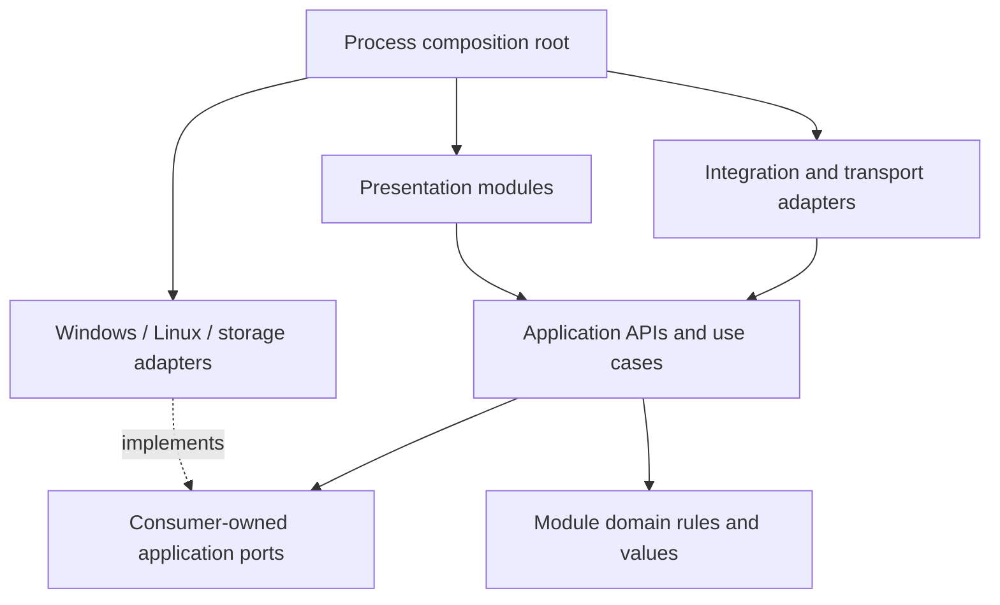

# Module layout and dependency contracts

Status: architecture blueprint, not implemented structure. This document assigns
ownership before implementation. Existing Hello World files/targets remain in place;
do not create empty directories or rename source trees just to resemble this plan.
Use architecture.md as the entry map, component-contracts.md for interface semantics
and process-lifecycle.md for background lifetime and update behavior.

## Domain boundaries and ownership

Module boundaries follow vocabulary, rules and data ownership, not executables,
operating systems, UI screens or technical facilities. These initial bounded-context
candidates are deliberately small and can be revised when hardware behavior is known.

| Module | Meaning and rules | State ownership |
| --- | --- | --- |
| battery | Requested charge policy, valid limits and policy transitions; desired and effective state differ | Machine charge policy; effective battery state is observed from hardware |
| performance | Requested performance profile and allowed transitions; desired and effective mode differ | Machine device policy; effective mode is observed from its adapter |
| shortcuts | User binding configuration, trigger/action vocabulary and binding rules | Per-user bindings; OS/firmware key/lock state is observed, not owned by a binding |

Battery and performance are separate because changing one need not mutate the other's
rules or storage. Neither imports the other's domain. Hardware support/ranges are
verified inputs to policies, not constants guessed from UI controls. Actual storage
or observation can fail without invalidating the distinction between desired/effective.

Use a value object for an invariant-bearing value; introduce an aggregate only when
there is an actual identity/consistency boundary. A binding configuration may need
atomic replace; this does not imply a database, global Unit of Work or aggregate for
every device. Repository ports appear only when a use case needs persistent domain
state. Do not make every settings file a repository or every structure an entity.

These supporting modules do not require invented rich domains:

| Module | Owns | Does not own |
| --- | --- | --- |
| feedback | Session event-to-feedback policy, filtering/coalescing, OSD preferences | Hardware policy, key registration, render technology |
| overview | Read-model composition for status/settings UI | Other modules' authoritative state or mutations |
| diagnostics | Read-only capability/health/support reports, redaction | Firmware writes or automatic repairs hidden inside reads |
| lifecycle | Maintenance/update coordination and recovery state | Battery/shortcut rules, install technology or desktop rendering |
| ui_preferences | Per-user language/appearance values, persistence/change-feed contracts | Hardware policy or Qt rendering; this is a supporting application module |

Runtime roles are composition scopes, not new bounded contexts. A module can execute
in a machine host, session host or client through the appropriate adapter. Privileged
machine operations have one authoritative execution owner; clients do not run a second
copy of hardware policy that can bypass that owner.

## Planned source placement

Keep the current layer-first roots and group each layer by module. A context's domain
and application form independent build targets even though their directories are apart.
Names below are responsibility groups; create only the files required by a use case.

```text
domain/
  battery/                 # policy values/rules and actual domain facts
  performance/             # profile values/rules and actual domain facts
  shortcuts/               # binding values/rules; no global key hooks
  system/                  # existing host-platform vocabulary only
application/
  battery/{api,use_cases,ports}/
  performance/{api,use_cases,ports}/
  shortcuts/{api,use_cases,ports}/
  feedback/{api,use_cases,ports}/
  overview/                # current use case; subdivide as it grows
  diagnostics/{api,use_cases,ports}/
  lifecycle/{api,use_cases,ports}/
  ui_preferences/{api,use_cases,ports}/
adapters/
  integration/             # explicit cross-module mapping/routing, no domain rules
  local_api/               # inbound controllers/outbound clients and DTO mappers
  storage/                 # typed settings serialization, migrations, atomic files
  windows/
    hosting/               # SCM/logon/session and process-lifetime adapters
    battery/               # verified device APIs, not Qt UI
    performance/
    shortcuts/             # hotkeys, observed key state, vendor input sources
    ipc/                   # authenticated named-pipe transport
    paths/                 # Known Folders and identity-sensitive locations
    lifecycle/             # maintenance, stop/restart and installer OS operations
  linux/
    hosting/               # system/user/graphical-session host adapters
    battery/
    performance/
    shortcuts/             # Wayland/portal, X11 or verified device adapters
    ipc/                   # selected local authenticated transport
    paths/                 # XDG/system directories
    lifecycle/
  platform/                # existing host-info bootstrap declaration; not a service bag
presentation/
  common/{localization,appearance}/ # shared Qt controllers, not domain services
  i18n/                    # tracked Qt Linguist catalogs; generated QM stays in builds
  settings/{models,qml}/   # view models/controllers and settings windows
  tray/                    # optional tray client and menus
  osd/                     # non-activating feedback rendering, independent of tray
  notifications/           # desktop notification presenters
apps/
  desktop/                 # existing bootstrap until a scoped migration
  machine/{composition,windows,linux}/
  session/{composition,windows,linux}/
  client/                  # composition for tray/settings clients
  maintenance/             # if installer coordination needs a product helper
contracts/
  local_api/v1/            # published machine/session wire schemas and compatibility
packaging/{windows,linux}/ # deployment assets; no product behavior
tests/
  unit/{battery,performance,shortcuts,feedback,lifecycle}/
  contracts/               # reusable behavioral suites per implemented port
  integration/             # module mapping, persistence and authenticated IPC
  acceptance/{windows,linux}/ # installed lifecycle/update scenarios
```

Logical roots under apps do not prescribe executable count or launch flags. OS entry
points own host integration and assemble a common composition where valid. Composition
uses constructor injection and explicit ownership, not a global service locator or
runtime plugin system. A new hardware adapter need not become a dynamically loaded DLL.

No implementation files, build targets or empty source skeletons are added by this
blueprint. Windows/Linux API selection lives in adapters/composition and CMake;
shared use cases never include OS branches.

## Layer and module dependency rules



Arrows describe source dependencies, not event delivery or process communication.
Every node represents selected small module targets, not a single shared library.

| Owner | May depend on | Must not depend on |
| --- | --- | --- |
| domain/<module> | Standard C++ and that module's domain types | Qt, OS, storage, wire schemas, application, other module internals |
| application/<module> | Own domain, own request/result models and consumer-owned ports | Concrete adapters, presentation, apps, transport DTOs, other module internals |
| adapters/integration | Explicit public application APIs/ports of connected modules | Private use cases/domain state of another module, UI state |
| adapters/local_api | Application APIs/ports plus wire contracts; injected transport | Business policies or arbitrary OS hardware access |
| OS/storage adapters | The port they implement and necessary SDK/storage facilities | Presentation/windows, app entry points, hidden access to other modules |
| presentation/<client> | Published application-facing APIs/ports and UI frameworks | Concrete hardware/IPC/storage adapters, other clients' private view models |
| apps/<role> | Explicitly selected modules, adapters, presenters and host | Business rules or feature state copied into main |
| contracts/local_api | Standalone schema/value definitions | Domain entities, use-case implementations, UI frameworks or host APIs |

The dependency arrow points inward. Presentation and adapters are parallel outer
layers; presentation does not directly instantiate adapters. Apps is the composition
boundary that knows concrete types. Keep includes/visibility narrow: public includes
expose only api/ports, implementation headers are private. The current root-wide include
configuration is bootstrap state, not proof that these future rules are enforced.

Shared source text is not shared mutable state. No module reads another module's
settings files, domain members or database tables. No daemon links presentation.
No C++ globals for session identity, event bus, configuration or hardware controller.
Domain objects do not escape over IPC or become QML QObject models.

## Public APIs, ports and inter-module interaction

Each application module publishes the narrow commands/queries/results it needs in
api/. Inbound adapters validate syntax and caller identity before invoking input APIs;
the application/domain retain semantic authorization/invariant checks. Implementations
live in use_cases/, dependency abstractions in ports/. Prefer a returned result where
an extra abstract presenter interface adds no boundary value.

The consumer owns an outbound port. An adapter translates another module's public
API/result into that port, so the consumer does not import producer entities. Do not
make every module depend on a universal DeviceControl or StateEventSource superinterface.
Battery and performance have separate controls and observations; the feedback module
owns its normalized input model rather than depending on battery domain events.

For example, adapters/integration maps a confirmed battery application result to
feedback's input API. The feedback use case selects semantic feedback and invokes its
OSD port. A normalized shortcut intent is routed through an explicit outer integration
controller to the correct published input API, locally or via IPC. A use case does not
reach into another use case or UI model. Routing contains translation/dispatch only;
policy stays with its module and the machine owner still authorizes hardware commands.

Distinguish three things:

- Domain fact: an invariant-relevant event inside one context; no transport schema.
- Published application result/event: a deliberately selected stable projection for
  external consumers; no domain object reference or implicit mutable ownership.
- Wire message: versioned serialization under contracts/local_api, mapped by adapters.

No external broker, generic command bus, event sourcing, outbox or distributed
transaction is required for this desktop app. Use direct typed calls/subscriptions
where they suffice. Cancellation, bounded queues and resync are explicit contracts,
not magic supplied by naming something an event. IPC is optional for in-process
composition but mandatory across process/privilege boundaries; both preserve semantics.

## Ports by owner

Names are design vocabulary, not existing C++ declarations. Introduce each only with
its first concrete use case and a behavioral contract test.

| Owner | Outbound dependency examples |
| --- | --- |
| battery | ChargeControl, BatteryObservation, ChargePolicyStore |
| performance | PerformanceControl, PerformanceObservation, PerformancePolicyStore |
| shortcuts | InputBinding, KeyboardObservation, BindingStore, UserActionExecutor |
| feedback | FeedbackPresenter, NotificationPresenter, FeedbackPreferences |
| overview/diagnostics | Narrow snapshot/capability queries with per-source unavailable/error results |
| lifecycle | RuntimeMaintenance, PayloadInstaller, UpdateRecoveryStore |

Platform adapters implement only relevant ports. Hardware observations and ordinary
keyboard state are different sources. Capability, permission and unimplemented states
are explicit. Credential/IPC checks live in real endpoint adapters; fake interfaces
cannot grant authority. Multiuser machine-policy arbitration must be specified before
enabling mutations; do not silently take whichever session wrote last.

## Composition and data placement

| Scope | Composes | Persistent state |
| --- | --- | --- |
| Machine runtime | battery/performance authority, required device-event adapters, local API server and OS host | Machine policies, owned by background identity/admin |
| Session runtime | Session input, shortcut resolution/user actions, state clients, feedback policy and independent OSD host | That user's bindings/feedback preferences |
| Tray/settings client | Presentation models plus injected query/command clients | UI preferences only; no authoritative copy of machine policy |
| Maintenance | Lifecycle coordinator plus OS installer/host adapters | Owned manifest, maintenance/recovery record and migration state |

Use the same typed boundary if a role is colocated; do not bypass it by sharing raw
device pointers. Tray/settings closure does not destroy session-owned registrations
or OSD. A user action never executes under the machine daemon identity. Machine policy
must not depend on a logged-in user's GUI. Rendering stays in the graphical session.

Windows storage follows windows-installation.md. Linux maps machine policies to its
system config/state locations and user preferences to XDG directories through paths
adapters; choose exact Linux packaging paths before implementing that installer.
File storage adapters receive resolved paths and identity policy from composition;
application code never derives them from working directory or environment variables.
Do not introduce a common mutable Settings singleton or make UI write machine files.

## Build, test and growth boundaries

Language/appearance follow [Qt UI conventions](qt-ui-conventions.md); presentation
controllers are process-local and injected, with shared per-user preference propagation.

Evolve the current bootstrap libraries into small targets such as manager_battery_domain,
manager_battery_application, manager_battery_windows and manager_battery_linux, plus
separate presentation/transport/host targets when implemented. Link visibility and
DEPS rules must enforce layer and sibling-module restrictions. Do not create all these
targets now or link every adapter into a universal manager_core.

Domain/unit tests use standard C++. Application tests use owned-port fakes. Port contract
suites cover in-process/fake/implemented OS adapters; native integration tests cover
permissions, threading and platform APIs. Acceptance tests verify UI-independent
background behavior and installed A-to-B upgrades. Cross-platform compilation is not
hardware or Linux runtime acceptance. Machine binaries must not transitively link Qt
Gui/Quick/presentation; test that boundary when machine targets exist.

Add a feature as a vertical slice: vocabulary/invariants and input/output contracts,
focused tests, one application scenario, adapters for supported platforms with honest
capability states, composition, then presentation. Migrate existing overview_model and
Main.qml only when splitting presentation is actually needed. HostPlatform/read_overview
remain bootstrap diagnostics, not a seed for a giant system bounded context.

Before implementations that cross trust/thread boundaries, specify the concrete
identity policy, ownership/cancellation model, snapshot/resync behavior and compatibility
rules. A planned directory or interface name is not a claim of implemented behavior.
