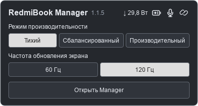
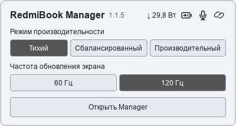
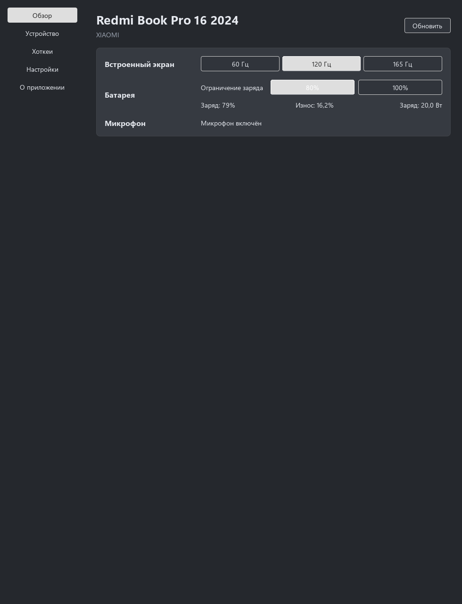
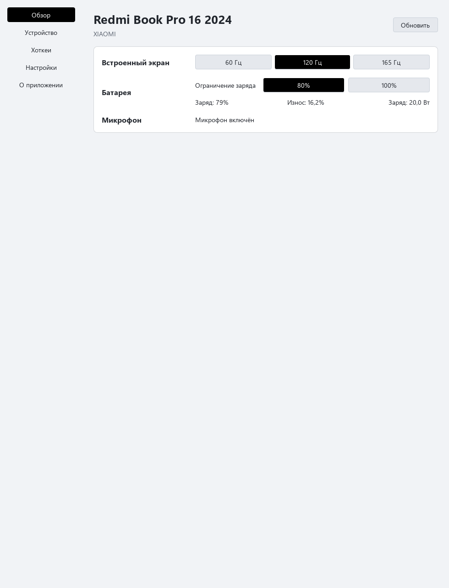
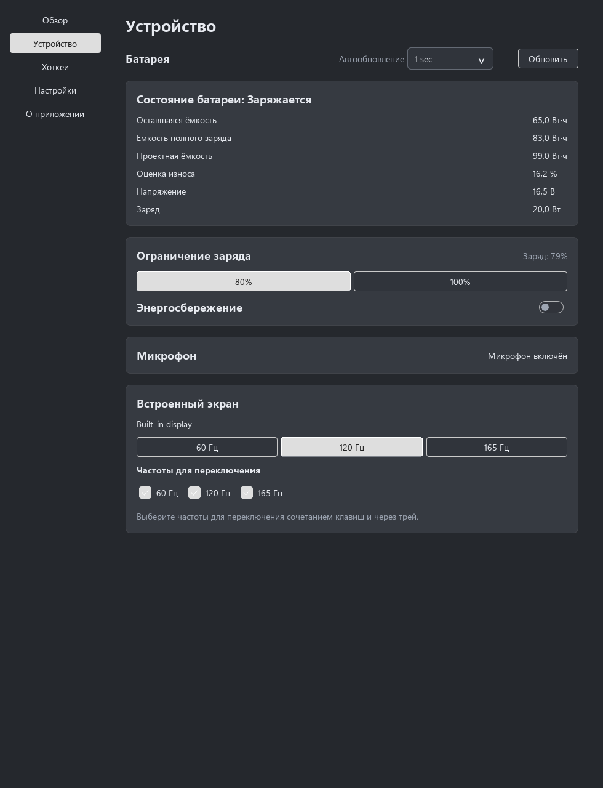
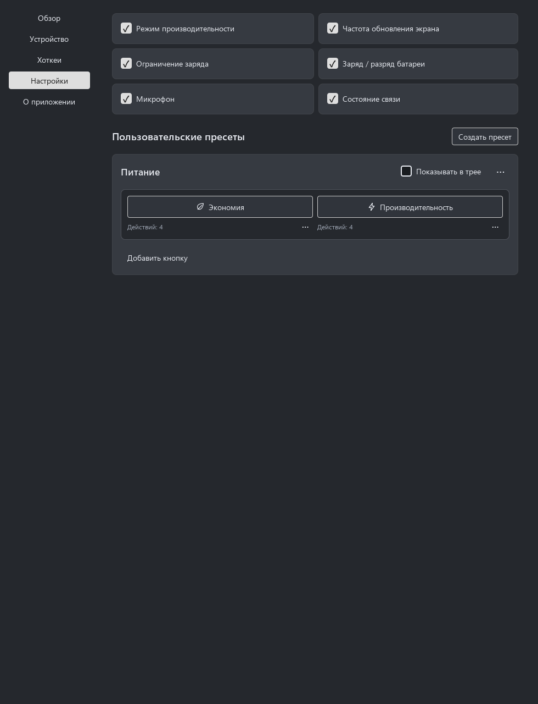

# Screenshots / Скриншоты

[English README](../README.md) · [Русский README](../README.ru.md)

Application-owned offscreen previews of version 1.1.5. All device values are
simulated fixtures, not measurements or evidence of native hardware acceptance.
The interface is shown in Russian; English is also supported. No desktop capture,
mouse/keyboard control or production setting changes were used.

Изолированные снимки версии 1.1.5. Все аппаратные значения демонстрационные;
они не являются измерениями и не подтверждают работу оборудования. Показан
русский интерфейс, английский также поддерживается. Рабочий стол не захватывался.

## Tray / Трей




## Overview / Обзор




## Device / Устройство



## Presets / Пресеты



## Reproduce / Повторить

Use a configured Windows build tree with the pinned Qt kit. This command builds
only preview targets and renders into .tools; it does not install or access hardware.
Используйте настроенный Windows build tree с закреплённой версией Qt. Команда
собирает только превью и создаёт снимки, без установки и аппаратных действий.

```powershell
cd <checkout>
./tools/render-previews.ps1 -BuildDirectory build/release -Build -PresetSettings -Style FluentWinUI3 -Theme Dark
```

Repeat with `-Theme Light` for light-theme captures. The script renders both tray
palettes. Fixture capabilities vary; screenshots need not show every supported
production feature. Preview source lives in tests/ui_preview.cpp and the desktop
preview composition; the screenshot is not a photo of the owner's desktop.
